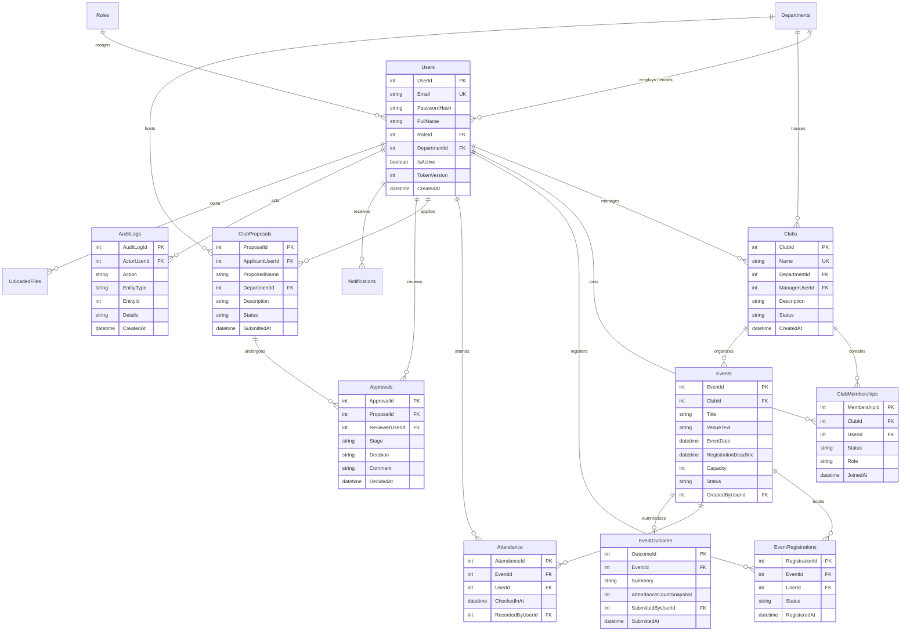
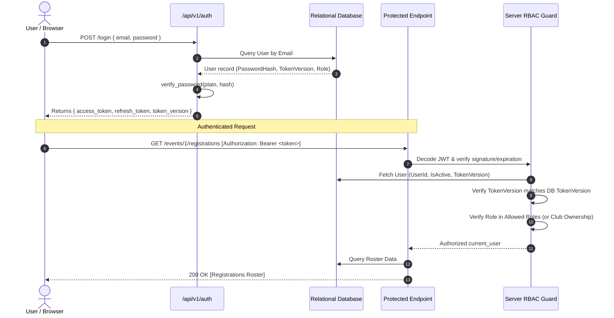

# ClubSphere — Comprehensive Codebase Audit & Architecture Specification

**Document Date:** October 18, 2026  
**Auditor:** Senior Software Architect & Full-Stack Security Specialist  
**Target Repository:** `ClubSphere_Project` (University Club & Activity Lifecycle Management Platform)  
**Version:** 1.0.0

---

## 1. Project Overview & Technology Stack

ClubSphere is an institutional web platform that streamlines the complete lifecycle of university student clubs, event scheduling, multi-tier approvals, capacity management, QR attendance tracking, and governance compliance.

### 1.1 Technology Inventory

| Layer | Technologies / Libraries | Purpose |
| :--- | :--- | :--- |
| **Backend Core** | Python 3.11+ / 3.15, FastAPI 0.143, Starlette | Asynchronous RESTful API framework |
| **ASGI Server** | Uvicorn 0.54 | Production & development ASGI server |
| **Data Access / ORM** | SQLAlchemy 2.1, Pydantic v2 (Pydantic-Settings) | Relational mapping, schema validation & DDL |
| **Database Engines** | SQLite 3 (Dev/Test), Azure SQL Database (Prod DDL) | Dual relational storage |
| **Security & Cryptography** | `bcrypt` 5.0, `PyJWT` 2.15 | Password salt-hashing, signed HMAC-SHA256 JWTs |
| **File Storage** | Azure Blob Storage SDK, local filesystem fallback | Multimodal document & asset management |
| **Frontend Framework** | React 19.2, TypeScript 6.0 | Component rendering, type safety |
| **Styling & Bundling** | Tailwind CSS v4, Vite 8.3 | Utility CSS engine, instant Hot Module Replacement |
| **Testing & Quality** | Pytest 9.1, AnyIO 4.15, Oxlint 1.81 | Automated test runners, linter, static analysis |
| **Orchestration** | `app.py` | Single-command cross-platform full-stack launcher |

---

## 2. Directory & Module Responsibilities

```
ClubSphere_Project/
├── app.py                             # Unified orchestrator (boots backend & frontend concurrently)
├── docker-compose.yml                 # Multi-container local deployment definition
├── backend/
│   ├── app/
│   │   ├── main.py                    # FastAPI application factory, lifespan, CORS, health route
│   │   ├── core/
│   │   │   ├── config.py              # Pydantic BaseSettings: DB, JWT, CORS, rate limits
│   │   │   ├── database.py            # Engine, sessionmaker, SQLite PRAGMA hook, healthcheck
│   │   │   ├── security.py            # Bcrypt hashing, JWT access/refresh token generation
│   │   │   ├── rbac.py                # Role normalization, require_roles dependency, ownership check
│   │   │   ├── audit.py               # Synchronous transactional audit logger
│   │   │   └── storage.py             # MIME/size file validation, filename sanitization, Blob/local storage
│   │   ├── models/
│   │   │   └── models.py              # 14 SQLAlchemy Declarative Models
│   │   ├── schemas/                   # Pydantic request/response validation schemas
│   │   │   ├── auth.py, club.py, event.py, proposal.py,
│   │   │   ├── notification.py, audit.py, analytics.py, upload.py
│   │   └── api/v1/                    # Modular REST Routers
│   │       ├── auth.py                # Register, login, refresh, me, logout
│   │       ├── clubs.py               # Club discovery, join requests, manager roster updates
│   │       ├── events.py              # Event CRUD, registrations, attendance, outcomes
│   │       ├── proposals.py           # Club proposals submission, Faculty & HOD review chain
│   │       ├── notifications.py       # User in-app notifications & read receipts
│   │       ├── admin.py               # Institutional analytics overview, audit log inspection
│   │       ├── uploads.py             # Authenticated file uploads & attachments
│   │       ├── health.py              # API v1 health & DB probe
│   │       └── router.py              # Aggregated v1 API router
│   ├── tests/                         # 10 test suites (52 passing integration tests)
│   ├── sql/                           # Production SQL scripts & Power BI views
│   │   ├── azure_sql_schema.sql       # T-SQL DDL schema for Azure SQL
│   │   ├── power_bi_views.sql         # 4 institutional reporting views
│   │   └── seed_data.sql              # Synthetic university demo identities
│   ├── requirements.txt               # Backend dependencies
│   └── pyproject.toml                 # Pytest & packaging metadata
├── frontend/
│   ├── src/
│   │   ├── App.tsx                    # Interactive dashboard & live endpoint tester
│   │   ├── main.tsx                   # React root entry point
│   │   └── index.css                  # Tailwind v4 import & typography variables
│   ├── vite.config.ts                 # Dev server proxy configuration (/api & /health)
│   ├── package.json                   # React 19 dependencies & scripts
│   └── tsconfig.json                  # TypeScript compiler options
└── docs/                              # Project design documents, reports & OpenAPI contracts
```

---

## 3. High-Level Architecture Diagram

```mermaid
graph TD
    subgraph Client_Layer [Client Layer]
        Browser["React 19 Frontend (Vite @ :5173)"]
        Swagger["Swagger UI / OpenAPI Client"]
    end

    subgraph Reverse_Proxy [Development Proxy / Gateway]
        ViteProxy["Vite Dev Server Proxy (/api, /health)"]
    end

    subgraph Application_Layer [FastAPI Backend (:8000)]
        MainApp["FastAPI Core (main.py)"]
        Cors["CORS Middleware"]
        AuthMiddleware["JWT Bearer Authentication"]
        RBAC["Server-Side RBAC Guard (rbac.py)"]
        Routers["REST API Routers (/api/v1)"]
        AuditEngine["Transactional Synchronous Audit Logger"]
    end

    subgraph Data_Layer [Data & Storage Layer]
        SqlAlchemy["SQLAlchemy 2.0 ORM Engine"]
        SQLiteDB[("SQLite Database (Dev/Test)")]
        AzureSQL[("Azure SQL Database (Production)")]
        LocalUploads["Local Filesystem Storage (./uploads)"]
        AzureBlob["Azure Blob Storage Container"]
    end

    Browser -->|HTTP Requests| ViteProxy
    ViteProxy -->|Proxy Pass| MainApp
    Swagger -->|Direct HTTP| MainApp
    MainApp --> Cors --> AuthMiddleware --> RBAC --> Routers
    Routers --> AuditEngine
    Routers --> SqlAlchemy
    AuditEngine -->|Atomic Transaction| SqlAlchemy
    SqlAlchemy --> SQLiteDB
    SqlAlchemy -.->|Production Connection| AzureSQL
    Routers --> LocalUploads
    Routers -.->|Production Storage| AzureBlob
```

---

## 4. Complete API Endpoint Inventory

| HTTP Method | Path | Authentication / Role | Request Schema | Response Schema | Purpose |
| :--- | :--- | :--- | :--- | :--- | :--- |
| `GET` | `/health` | Public | None | JSON Object | Root readiness & DB smoke test |
| `GET` | `/api/v1/health` | Public | None | JSON Object | API v1 readiness probe |
| `POST` | `/api/v1/auth/register` | Public | `UserRegisterRequest` | `UserResponse` | Student account registration |
| `POST` | `/api/v1/auth/login` | Public | `UserLoginRequest` | `TokenResponse` | Authenticate & issue JWT pair |
| `POST` | `/api/v1/auth/refresh` | Public | `TokenRefreshRequest` | `TokenResponse` | Rotate refresh token & issue new access token |
| `GET` | `/api/v1/auth/me` | Authenticated | None | `UserResponse` | Fetch current user profile |
| `GET` | `/api/v1/clubs` | Public / Filtered | Query params (dept, status, search, page) | `ClubListResponse` | Paginated club discovery |
| `GET` | `/api/v1/clubs/{id}` | Public | None | `ClubResponse` | Club details and member count |
| `POST` | `/api/v1/clubs` | `Administrator` | `ClubCreateRequest` | `ClubResponse` | Direct club creation override |
| `PUT` | `/api/v1/clubs/{id}` | Club Manager / Admin | `ClubUpdateRequest` | `ClubResponse` | Update club profile or status |
| `POST` | `/api/v1/clubs/{id}/join` | Authenticated | None | `MembershipJoinResponse` | Submit club membership request |
| `GET` | `/api/v1/clubs/{id}/members` | Club Manager / Admin | Query params (status, pagination) | `MembershipListResponse` | Roster of club applicants and members |
| `PUT` | `/api/v1/clubs/{id}/members/{id}`| Club Manager / Admin | `MembershipUpdateRequest` | `MembershipMemberResponse` | Approve/reject membership or promote |
| `GET` | `/api/v1/events` | Public | Query params (club, date, status, page) | `EventListResponse` | Published events list with live seats |
| `GET` | `/api/v1/events/{id}` | Public | None | `EventResponse` | Event details, deadline, seats left |
| `POST` | `/api/v1/events` | Club Manager / Admin | `EventCreateRequest` | `EventResponse` | Create event under manager's club |
| `PUT` | `/api/v1/events/{id}` | Club Manager / Admin | `EventUpdateRequest` | `EventResponse` | Update event information or status |
| `POST` | `/api/v1/events/{id}/register` | Authenticated | None | `RegistrationResponse` | Register student for event |
| `DELETE` | `/api/v1/events/{id}/register` | Authenticated (Owner) | None | JSON Object | Cancel confirmed event registration |
| `GET` | `/api/v1/events/{id}/registrations`| Club Manager / Admin | Query params (pagination) | `RegistrationListResponse` | Full attendee roster with check-in flags |
| `POST` | `/api/v1/events/{id}/attendance`| Club Manager / Admin | `AttendanceRecordRequest` | `AttendanceResponse` | Mark attendance for confirmed students |
| `GET` | `/api/v1/events/{id}/outcomes` | Public | None | `EventOutcomeResponse` | Post-event outcome report metrics |
| `POST` | `/api/v1/events/{id}/outcomes` | Club Manager / Admin | `EventOutcomeCreateRequest` | `EventOutcomeResponse` | Submit event outcome report |
| `POST` | `/api/v1/proposals` | Authenticated | `ProposalCreateRequest` | `ProposalResponse` | Submit new club proposal |
| `GET` | `/api/v1/proposals` | Role-Scoped | Query params (status, page) | `ProposalListResponse` | List proposals (students see own; reviewers see pending) |
| `GET` | `/api/v1/proposals/{id}` | Role-Scoped | None | `ProposalResponse` | Detailed proposal & review history |
| `POST` | `/api/v1/proposals/{id}/review` | Faculty, HOD, Admin | `ProposalReviewRequest` | `ProposalResponse` | Review decision; HOD approval activates club |
| `GET` | `/api/v1/notifications` | Authenticated | None | `NotificationListResponse` | Fetch user notifications & unread count |
| `PUT` | `/api/v1/notifications/{id}/read`| Authenticated (Owner) | None | `NotificationResponse` | Mark individual notification read |
| `PUT` | `/api/v1/notifications/read-all`| Authenticated | None | JSON Object | Mark all notifications read |
| `GET` | `/api/v1/admin/analytics/overview`| HOD, Administrator | None | `AnalyticsOverviewResponse` | Aggregated institutional metrics |
| `GET` | `/api/v1/admin/audit-logs` | `Administrator` | Query params (actor, entity, dates, page) | `AuditLogListResponse` | Query immutable audit log |
| `POST` | `/api/v1/uploads` | Authenticated | Multipart Form (file, entity_type, entity_id) | `UploadResponse` | Upload attachment with validation |

---

## 5. Database Entity Relationship Diagram



---

## 6. Authentication & Authorization Flow



---

## 7. Major Business Workflows

### 7.1 Multi-Tier Club Proposal & Activation Lifecycle
1. **Submission**: Student submits proposal (`POST /api/v1/proposals`). Duplicate pending or active club names are rejected.
2. **Faculty Review (Stage 1)**: Department faculty coordinator evaluates proposal (`POST /api/v1/proposals/{id}/review`). Decision can be `approve` (recommendation), `changes_requested`, or `reject`.
3. **HOD Final Decision (Stage 2)**: Head of Department records final review.
4. **Automated Activation**: Upon HOD `approve`:
   - `Club` entity is created and marked `active`.
   - `ClubMembership` record is created assigning applicant as `Lead`.
   - `AuditLog` entry is synchronously written in the same transaction.
   - Applicant receives automated in-app notification.

### 7.2 Event Lifecycle & Strict Capacity Registration
1. **Creation**: Club Manager creates event under their club (`POST /api/v1/events`). Constraint `RegistrationDeadline <= EventDate` is strictly validated.
2. **Registration**: Student registers (`POST /api/v1/events/{id}/register`).
   - Rejects if `now > RegistrationDeadline`.
   - Rejects if student already confirmed (`UQ_Event_User_Reg`).
   - Evaluates confirmed count against `Capacity`.
3. **Attendance**: Club manager marks attendance (`POST /api/v1/events/{id}/attendance`). Only confirmed registered students can be checked in.
4. **Outcomes & Closure**: Club manager files outcome summary (`POST /api/v1/events/{id}/outcomes`), verified attendance snapshot is frozen, and event transitions to `completed`.

---

## 8. Technical Debt & Identified Risks

1. **Token Invalidation Gap**: Revocation mechanism (`TokenVersion`) defined in SQL schema but not enforced in JWT payloads or route guards.
2. **Capacity Concurrency Window**: `SELECT COUNT` before `INSERT` lacks pessimistic row lock (`with_for_update()`) on SQLite/Azure SQL.
3. **Upload Security Incomplete**: Absence of magic byte verification and file extension allowlist.
4. **Frontend View Coverage**: Core components and multi-role views in React need to be connected to the typed API client.
