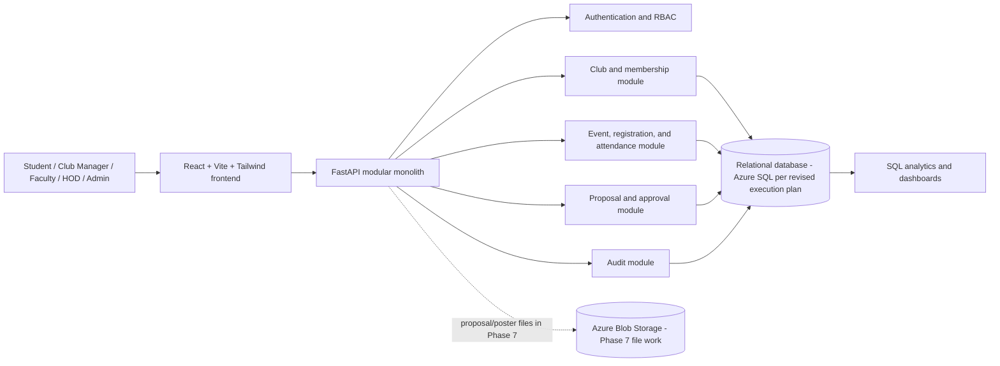
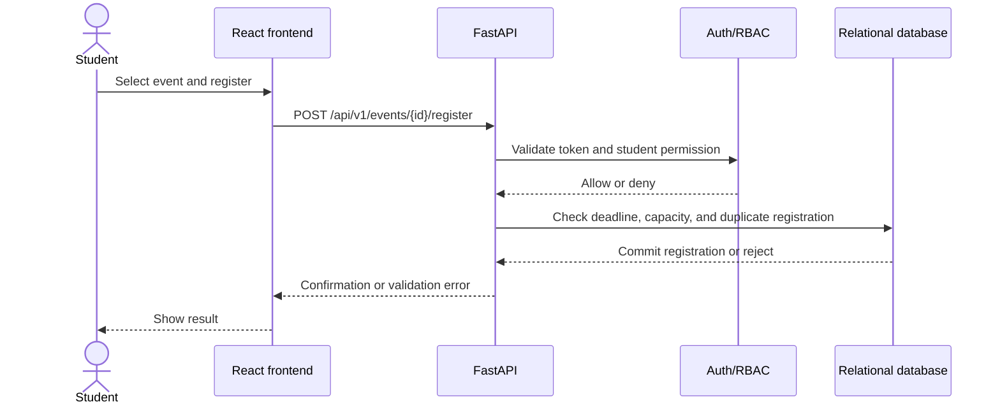

# ClubSphere Phase 1 Requirements and Architecture Draft

## Purpose

This draft turns the revised execution plan and combined project proposal into an MVP requirements baseline and two Mermaid diagrams. It is for Aryan and Vanshika to review before Design Review. The project name in the repository is ClubSphere; the supplied proposal still uses CampusConnect and should be updated to the agreed name.

## MVP scope

Build a role-based university club and activity lifecycle application. The required lifecycle is: propose a club, complete faculty and HOD review, activate an approved club, create an event, let students register, record attendance, and report basic activity metrics.

MVP roles: Student, Club Manager, Faculty, HOD, and Administrator.

Out of MVP unless the team explicitly reopens scope: recommendation/ranking engine, Redis, QR attendance, email/calendar integration, graph analysis, and an analytical warehouse/ETL pipeline. Search and filtering for clubs and events remain ordinary MVP discovery features.

## Functional requirements

| ID | Requirement | Acceptance check |
| --- | --- | --- |
| FR-01 | Users can register and log in; protected operations enforce the five agreed roles on the server. | Valid credentials establish a session/token; unauthorized roles receive a denial for protected actions. |
| FR-02 | Students can browse and search clubs, view club profiles, and request or join membership. | The directory shows active clubs; a student can view a profile and submit a membership action. |
| FR-03 | Club Managers can manage their club profile and create/publish events with a date, capacity, and registration deadline. | Invalid capacity or a deadline after the event date is rejected. |
| FR-04 | Students can browse events and register before the deadline while capacity remains. | Duplicate registration, late registration, and over-capacity registration are rejected; successful registration is recorded once. |
| FR-05 | A student/applicant can submit a club proposal for faculty review followed by HOD review. | Each decision, reviewer, timestamp, and comment is recorded; an approved proposal can activate a club. |
| FR-06 | An authorized Club Manager can record attendance for confirmed event registrants and submit an event outcome. | Attendance cannot be recorded twice for the same event and student; the attendance total can be reconciled to registrations. |
| FR-07 | Club Managers and administrators can view dashboards scoped to their permissions. | Manager views are limited to their club; administrator views can summarize clubs, events, and audit activity. |
| FR-08 | The system provides basic SQL-backed activity analytics. | Registration and attendance figures can be checked against source records with manual SQL queries. |
| FR-09 | Sensitive actions are recorded in an audit trail. | Proposal decisions and administrative changes record actor, action, entity, and time. |

## Non-functional requirements

| ID | Requirement | Acceptance check |
| --- | --- | --- |
| NFR-01 | Enforce least-privilege access in backend routes; do not rely on frontend hiding controls. | Role/ownership denial checks cover protected operations. |
| NFR-02 | Store password hashes, keep credentials out of source control, and use HTTPS for deployed traffic. | Repository contains no real secrets; deployed site and API use HTTPS. |
| NFR-03 | Maintain relational integrity for memberships, registrations, and attendance. | Unique and foreign-key constraints prevent duplicate or orphan records. |
| NFR-04 | Use synthetic demonstration accounts and data; do not place real student personal information in the demo dataset. | Seed data uses fictitious identities and a reserved demo email domain. |
| NFR-05 | Make the frontend usable at 375 px, 768 px, and 1280 px viewport widths. | Responsive checks at each width show no horizontal overflow or unusable controls. |
| NFR-06 | Keep the backend as a modular monolith with documented API contracts. | API routes are grouped by domain and documented through the agreed OpenAPI contract. |

## High-level architecture

## Event registration flow

## Decisions to confirm with Aryan

1. The revised execution plan and SDD use Azure SQL, while the proposal recommends PostgreSQL (and permits PostgreSQL/MySQL). This draft uses Azure SQL as the implementation baseline because the revised plan is the working execution authority; confirm that the team accepts the resulting change to the proposal.
2. The proposal makes object storage dependent on hosting choice; the revised plan schedules Azure Blob upload/download as a required Phase 7 deliverable. Keep it out of Phase 1 implementation, but confirm the Azure choice before deployment work.
3. The proposal mentions review of pending events, but the planned lifecycle defines faculty/HOD approval for club proposals and manager publication for events. Confirm that a separate event-approval workflow is out of MVP.
4. The proposal includes notifications, but the plan does not assign notification delivery in the MVP schedule and treats email integration as optional. Confirm whether in-app notifications are MVP or deferred.
5. The proposal says PostgreSQL/MySQL and generic cloud hosting; the revised plan selects Azure SQL and Azure services. Update the proposal/SDD after team confirmation so the deliverables agree.

## Review record

- Draft owner: Vanshika
- Required reviewer: Aryan
- Status: Draft for review; open decisions above must be recorded before the Design Review version is finalized.
